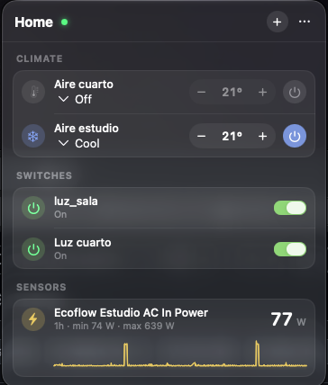
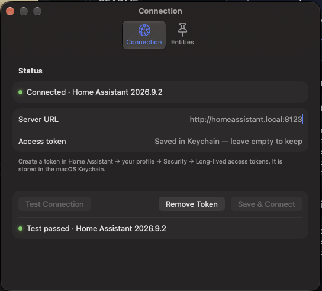

# HA Menu Bar

A native macOS menu bar app for [Home Assistant](https://www.home-assistant.io/). Click the house icon to open a compact, dark panel with the devices you choose: scenes, lights, switches, air conditioners and live power readings. You don't need to open a browser or a full dashboard.

State updates live over the Home Assistant WebSocket API, so changes made anywhere else show up immediately.

> Not affiliated with or endorsed by the Home Assistant project.

<p align="center">
  
  &nbsp;&nbsp;
  
</p>

## Features

- **Menu bar panel.** It opens from the menu bar with a single click, and the app has no Dock icon.
- **Live state.** The app uses a WebSocket subscription to `state_changed` and reconnects automatically with backoff, after sleep and when a heartbeat fails.
- **Instant feedback.** Toggles, sliders and steppers update the panel right away, before Home Assistant confirms the change.
- **Controls by entity type:**

  | Domain | Control |
  | --- | --- |
  | `scene`, `script`, `button`, `input_button` | Tappable tiles |
  | `light` | Toggle and brightness slider |
  | `switch`, `input_boolean`, `fan`, `automation` | Toggle |
  | `cover` | Open, stop and close buttons |
  | `climate` | Power button, mode menu (cool, heat, dry, fan, auto) and −/+ temperature stepper |
  | `sensor`, `binary_sensor` | Read-only value |
  | Power sensors (`device_class: power`, or unit W/kW) | Current value, one-hour sparkline and the hour's minimum and maximum |

- **Smart climate power-on.** Turning an AC back on restores the last mode it ran in, or falls back to Cool. Without this, Home Assistant's default `turn_on` can pick Heat.
- **Entity picker.** Search all your entities, pin the ones you want and drag them into order.
- **Connection status** with a colored dot in both the panel and Settings.

## Requirements

- macOS 14 Sonoma or later
- Xcode 16 or later (Swift 6)
- A Home Assistant instance reachable from your Mac

## Installation

```sh
git clone https://github.com/hebert992/ha-menu-bar.git
cd ha-menu-bar
scripts/bundle.sh --install      # builds, signs ad hoc, and copies to ~/Applications
open ~/Applications/HAMenuBar.app
```

To build without installing, run `scripts/bundle.sh`. The app is written to `build/HAMenuBar.app`.

## Setup

1. **Create a token.** In Home Assistant, open your profile, go to the **Security** tab, then **Long-lived access tokens → Create token**. Copy it, because it is shown only once.
2. **Connect.** Click the house icon, then open **Settings → Connection**. Enter your server URL (for example `http://homeassistant.local:8123`) and paste the token. Click **Test Connection**, then **Save & Connect**.
3. **Pin entities.** Click **+** in the panel, search for and tick your entities, then drag them into order.
4. **Start at login (optional).** Open **System Settings → General → Login Items** and add `HAMenuBar.app`.

## Privacy and security

- The access token is stored only in the macOS **Keychain**, as a generic password with service `dev.hebert.hamenubar`. It is never written to disk in plain text or logged.
- The server URL and pinned entity IDs are kept in UserDefaults.
- The app talks only to your Home Assistant server. It has no telemetry and sends nothing to third parties.
- `NSAllowsArbitraryLoads` is enabled so that plain HTTP on a LAN address works. Use `https` for any server reachable from the internet.

## Development

```sh
swift build
swift test
```

The project is a plain Swift Package with no `.xcodeproj`. `scripts/bundle.sh` wraps the release binary in an `.app` bundle using `Support/Info.plist`.

| Folder | Contents |
| --- | --- |
| `Sources/HAMenuBar/App` | App entry point, scenes, and `HomeStore` (the `@MainActor @Observable` UI state) |
| `Sources/HAMenuBar/Domain` | Pure, tested logic: entities, the action-to-service mapping, HVAC modes, optimistic updates, power history and panel layout |
| `Sources/HAMenuBar/Infrastructure` | WebSocket protocol and client, Keychain and settings storage |
| `Sources/HAMenuBar/UI` | SwiftUI views: panel, tiles, rows, climate, power sparkline, settings and picker |
| `Tests/HAMenuBarTests` | Swift Testing suites for the domain and protocol layers |

## Known limitations

- The app is signed ad hoc, so macOS may ask for Keychain access again after each rebuild. Choose **Always Allow**.
- The sparkline's history comes from the Home Assistant recorder. If the recorder is disabled, the line starts empty and fills from live updates.
- Climate devices in dual-setpoint mode (`target_temp_low`/`target_temp_high`) show their state, but the −/+ stepper is disabled.

## License

[MIT](LICENSE). Use it, fork it, modify it and ship it, commercially or not.
